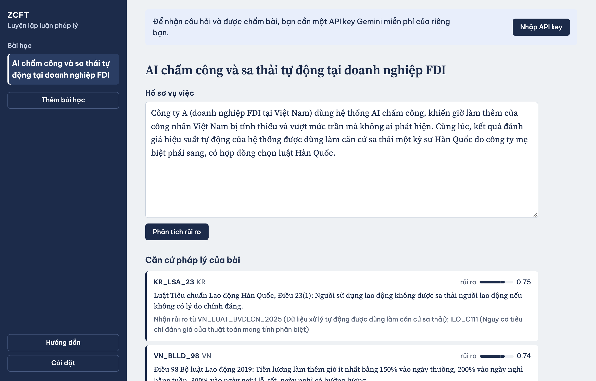
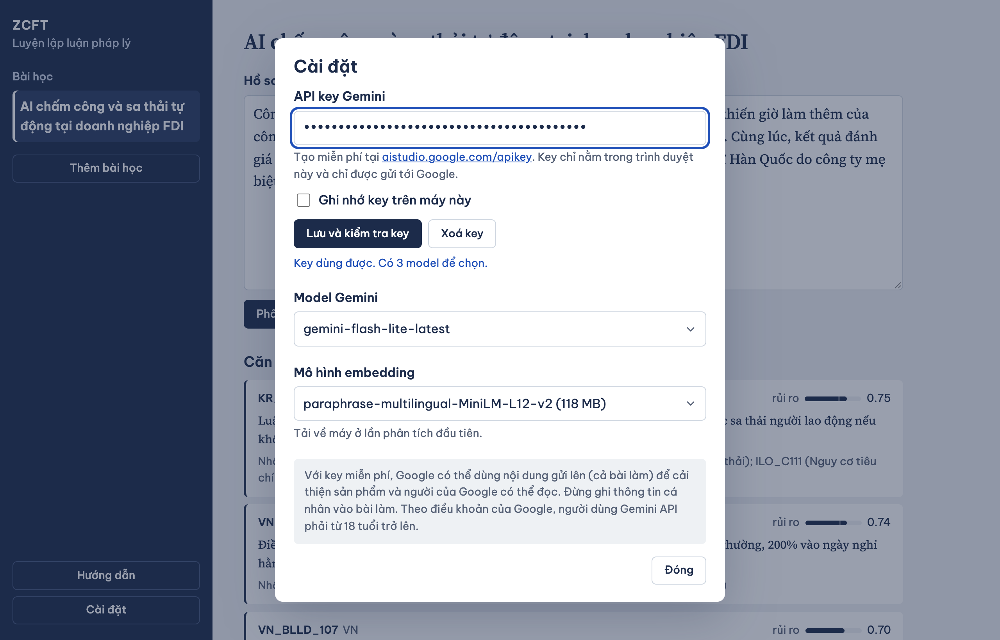
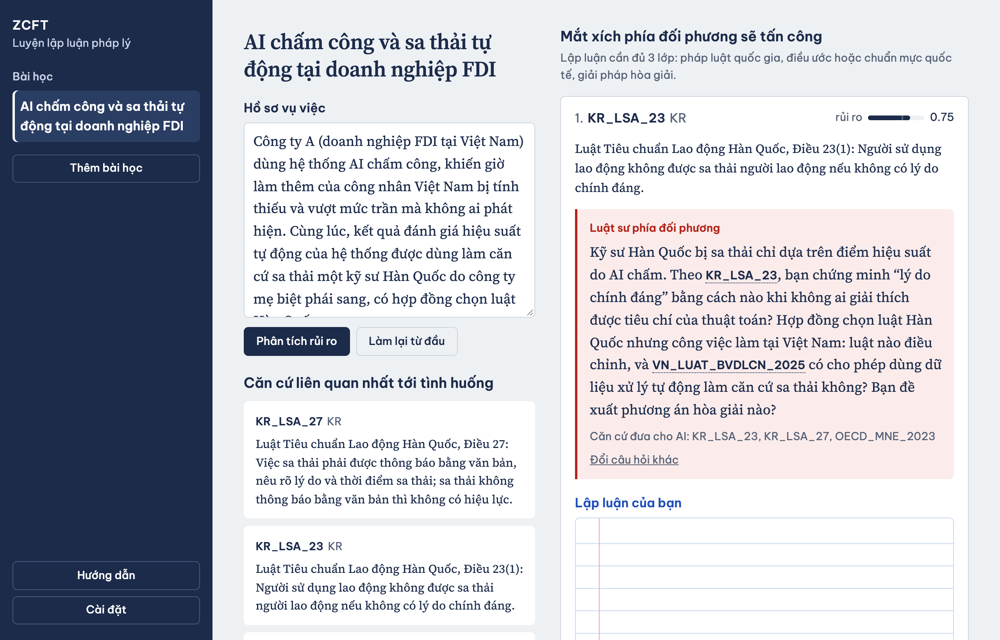
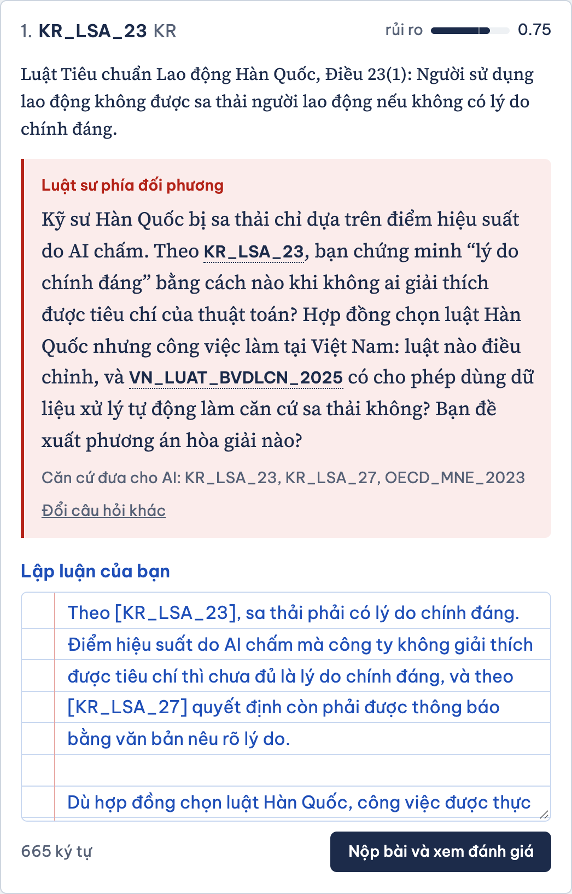
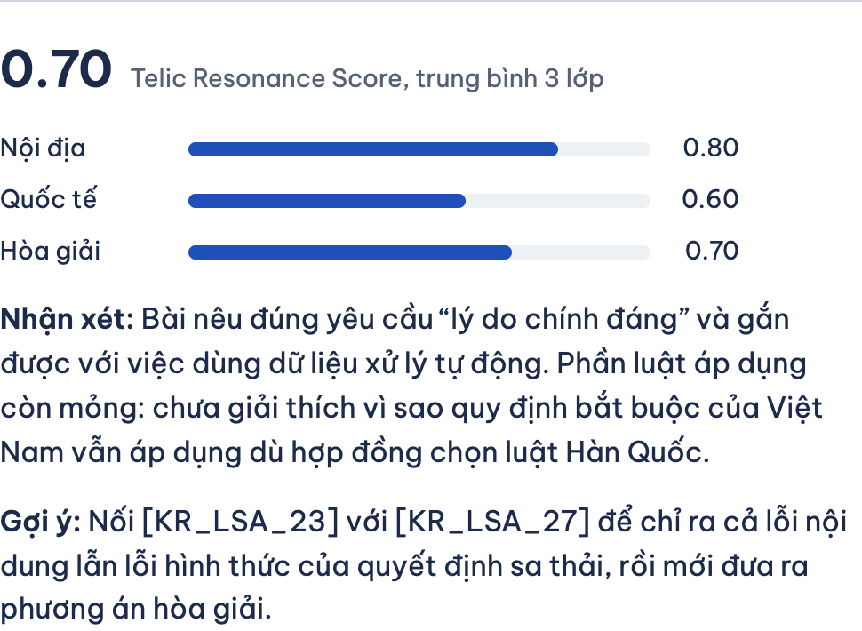
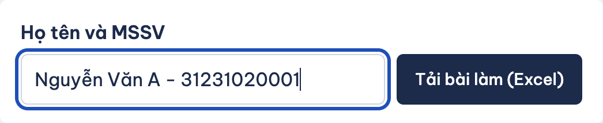
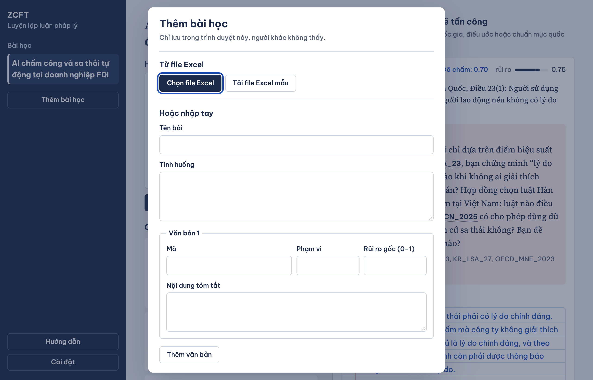

# Hướng dẫn sử dụng ZCFT

ZCFT là trang luyện lập luận pháp lý 3 lớp: pháp luật quốc gia, điều ước hoặc chuẩn mực quốc tế, và giải pháp hòa giải. Bạn đọc hồ sơ vụ việc, trả lời câu hỏi phản biện của "luật sư phía đối phương" do Gemini đóng vai, rồi nhận điểm và nhận xét.

Trang chạy hoàn toàn trong trình duyệt, không cần cài đặt và không cần đăng nhập.

## 1. Màn hình chính

- **Cột trái:** danh sách bài học, nút **Thêm bài học** và nút **Cài đặt**. Trên điện thoại, cột này nằm sau nút menu ở đầu trang.
- **Hồ sơ vụ việc:** tình huống của bài. Bạn có thể sửa trực tiếp trong ô này để thử một biến thể khác của vụ việc.
- **Căn cứ pháp lý của bài:** các văn bản, điều khoản mà giảng viên đưa vào bài. Mỗi văn bản có một mã (ví dụ `VN_BLLD_107`), phạm vi (`VN`, `KR`, `INT`…) và thanh **rủi ro** từ 0 đến 1.
- Dòng **"Nhận rủi ro từ…"** cho biết rủi ro của văn bản này tăng lên do văn bản nào khác kéo theo. Vạch nhỏ trên thanh rủi ro là mức gốc trước khi cộng phần kéo theo đó.

## 2. Nhập API key Gemini

Câu hỏi phản biện và việc chấm bài do Gemini thực hiện, nên mỗi người cần một API key miễn phí của riêng mình.

1. Mở [aistudio.google.com/apikey](https://aistudio.google.com/apikey), đăng nhập tài khoản Google và tạo key.
2. Trên trang ZCFT, bấm **Nhập API key** (hoặc **Cài đặt** ở cột trái).
3. Dán key vào ô **API key Gemini** rồi bấm **Lưu và kiểm tra key**.
4. Khi thấy dòng **"Key dùng được. Có … model để chọn."** thì bấm **Đóng**.

Các mục khác trong hộp thoại:

| Mục | Ý nghĩa |
| --- | --- |
| **Ghi nhớ key trên máy này** | Bỏ trống: key mất khi đóng tab. Đánh dấu: key được giữ lại cho lần sau. Không đánh dấu trên máy dùng chung. |
| **Xoá key** | Xoá key khỏi trình duyệt. |
| **Model Gemini** | Model dùng để đặt câu hỏi và chấm bài. Hạn mức miễn phí tính riêng cho từng model, nên khi hết lượt có thể đổi sang model khác. |
| **Mô hình embedding** | Mô hình tìm căn cứ liên quan tới tình huống. Nó chạy ngay trên máy bạn và được tải về ở lần phân tích đầu tiên (118 MB với lựa chọn mặc định). |

> **Quyền riêng tư:** key chỉ nằm trong trình duyệt của bạn và chỉ được gửi tới Google. Với key miễn phí, Google có thể dùng nội dung gửi lên (kể cả bài làm) để cải thiện sản phẩm và người của Google có thể đọc. Đừng ghi thông tin cá nhân vào bài làm. Theo điều khoản của Google, người dùng Gemini API phải từ 18 tuổi trở lên.

## 3. Phân tích rủi ro

Đọc (và sửa nếu muốn) **Hồ sơ vụ việc**, rồi bấm **Phân tích rủi ro**.

Lần đầu tiên, trang sẽ tải mô hình embedding và hiện tiến độ ngay dưới nút. Những lần sau không phải tải lại.

Sau khi phân tích, trang hiện thêm hai phần:

- **Căn cứ liên quan nhất tới tình huống:** các văn bản khớp nhất với nội dung hồ sơ. Đây cũng là những văn bản được đưa cho AI làm căn cứ.
- **Mắt xích phía đối phương sẽ tấn công:** các văn bản có rủi ro từ ngưỡng của bài trở lên, xếp từ cao xuống thấp. Mỗi mắt xích là một thẻ kèm một câu hỏi phản biện.

Nút **Làm lại từ đầu** xoá toàn bộ câu hỏi, bài làm và điểm của bài đang mở, đồng thời đưa hồ sơ về nội dung gốc.

## 4. Trả lời câu hỏi phản biện

Trong mỗi thẻ mắt xích:

- Khung đỏ **Luật sư phía đối phương** là câu hỏi bạn phải trả lời. Rê chuột vào mã văn bản được gạch chân để xem nội dung văn bản đó.
- **Căn cứ đưa cho AI** liệt kê những văn bản AI được phép dựa vào. Bài của bạn cũng được chấm theo đúng các văn bản này.
- **Đổi câu hỏi khác** lấy một câu hỏi mới cho mắt xích này. Điểm cũ của mắt xích sẽ bị xoá và tốn thêm một lượt gọi Gemini.
- Viết bài vào ô **Lập luận của bạn**. Bài cần ít nhất 20 ký tự và nên đủ 3 lớp:
  1. pháp luật quốc gia;
  2. điều ước hoặc chuẩn mực quốc tế (hoặc lập luận về luật nào được áp dụng);
  3. giải pháp hòa giải hay giải quyết tranh chấp.
- Nên dẫn văn bản bằng mã trong ngoặc vuông, ví dụ `[KR_LSA_23]`.

Bài làm được lưu tự động trong trình duyệt khi bạn gõ. Đóng tab rồi mở lại vẫn còn.

Viết xong, bấm **Nộp bài và xem đánh giá**.

## 5. Xem đánh giá

- Ba thanh **Nội địa**, **Quốc tế**, **Hòa giải** là điểm của từng lớp, từ 0 đến 1.
- Số lớn ở trên là **Telic Resonance Score**, tức trung bình cộng của ba lớp.
- **Nhận xét** nêu điểm mạnh và điểm yếu của bài; **Gợi ý** chỉ hướng lập luận tốt hơn.
- Độ dài không phải tiêu chí chấm. Trình bày sai nội dung văn bản sẽ bị trừ điểm.

Bạn có thể sửa bài và nộp lại bao nhiêu lần tuỳ ý. Khi bài đã sửa sau lần chấm gần nhất, trang sẽ nhắc bạn nộp lại để chấm bản mới.

## 6. Tải bài làm

Cuối danh sách mắt xích, điền **Họ tên và MSSV** rồi bấm **Tải bài làm (Excel)**.

File tải về có tên dạng `bai-lam_<họ-tên>_<tên-bài>.xlsx`, gồm tình huống, câu hỏi, bài làm và điểm của những mắt xích bạn đã làm. Nộp file này cho giảng viên theo cách giảng viên yêu cầu.

## 7. Thêm bài học

Bấm **Thêm bài học** ở cột trái. Bài thêm theo cách này chỉ lưu trong trình duyệt đang dùng, người khác không thấy.

### Từ file Excel

1. Bấm **Tải file Excel mẫu**.
2. Điền ba trang của file:

   | Trang | Nội dung |
   | --- | --- |
   | **Thông tin** | Tên bài, tình huống, và ba cài đặt: *Ngưỡng rủi ro*, *Hệ số lan truyền*, *Số căn cứ đưa cho AI* (có thể để nguyên). |
   | **Văn bản** | Mỗi dòng một văn bản hoặc điều khoản: *Mã*, *Phạm vi*, *Nội dung tóm tắt*, *Rủi ro gốc (0–1)*. Mã phải khác nhau, viết liền không dấu. |
   | **Liên kết** | Rủi ro của văn bản ở cột *Từ văn bản* truyền sang văn bản ở cột *Tới văn bản*. |

   Trang **Hướng dẫn** trong file giải thích chi tiết từng cột. Rủi ro có thể gõ `0,7`, `70%` hoặc `70`.
3. Quay lại hộp thoại, bấm **Chọn file Excel** và chọn file vừa điền. Nếu file có dòng sai, trang liệt kê ở mục **Lưu ý khi đọc file bài học**.

### Nhập tay

Điền **Tên bài**, **Tình huống** và ít nhất một văn bản, rồi bấm **Lưu bài học**. Cách này không khai báo được liên kết giữa các văn bản; cần liên kết thì dùng file Excel.

### Thêm văn bản vào bài đang mở

Dưới danh sách **Căn cứ pháp lý của bài**, mở mục **Thêm văn bản vào bài này**, điền mã, phạm vi, rủi ro gốc và nội dung tóm tắt. Văn bản tự thêm có nút **Xoá văn bản này**.

### Xoá bài học

Bài bạn tự thêm nằm dưới nhóm **Trên máy này** ở cột trái; bấm dấu ✕ cạnh tên bài để xoá. Bài có sẵn của trang thì không xoá được.

### Đưa bài học cho cả lớp

Bài học dùng chung do người quản lý trang đặt vào thư mục `public/lessons/` của mã nguồn; tên file là tên bài.

## 8. Câu hỏi thường gặp

**Một bài tốn bao nhiêu lượt gọi Gemini?**
Một lượt cho toàn bộ câu hỏi, cộng một lượt cho mỗi lần nộp bài. Bài có 5 mắt xích, mỗi mắt xích nộp một lần, là 6 lượt.

**Báo "Đã hết lượt gọi miễn phí trong lúc này".**
Đợi khoảng một phút rồi thử lại, hoặc vào **Cài đặt** đổi sang model khác.

**Báo "API key không hợp lệ".**
Kiểm tra xem đã sao chép đủ cả key chưa, rồi bấm **Lưu và kiểm tra key** lần nữa.

**Không tải được mô hình embedding.**
Trang tự chuyển sang tìm căn cứ theo từ ngữ và vẫn dùng được bình thường. Có thể chọn mô hình khác trong **Cài đặt**.

**Không có mắt xích nào hiện ra.**
Không văn bản nào đạt ngưỡng rủi ro của bài. Hạ **Ngưỡng rủi ro** ở trang *Thông tin* của file Excel, hoặc tăng rủi ro gốc của văn bản.

**Đổi máy hoặc đổi trình duyệt thì bài làm còn không?**
Không. Bài làm, bài học tự thêm và key đều nằm trong trình duyệt đang dùng. Hãy tải bài làm về trước khi đổi máy hoặc xoá dữ liệu trình duyệt.
